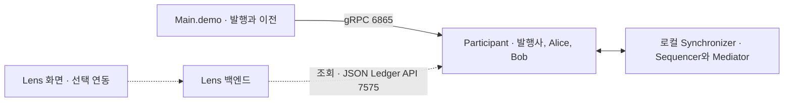

# Canton 로컬 모의 발행

## 업무 플랫폼 실증

기존 사설망에 Keycloak 로그인, 발행 요청·승인 업무 화면, 기관별 PQS·PostgreSQL 조회를 연결했다. [구성도, 공식 코드 출처 및 재현 방법](platform/README.md)

## 2개 Participant에서 DSRV Canton Lens 실행

Windows x64에서 JDK 21, Node.js 22.18 이상, PowerShell, Git을 준비한다. 저장소 루트에서 아래 명령을 실행한다. 첫 실행은 Canton SDK와 고정된 버전의 DSRV Lens를 내려받고 공식 IOU 예제를 빌드한다. 이후에는 두 번째 명령으로 저장된 원장을 다시 띄운다.

```powershell
.\Start-CantonLens.ps1 -Prepare
.\Start-CantonLens.ps1
```

- [발행기관 Lens](http://127.0.0.1:5173/#/contracts)는 자체 보유분 900과 증권사에 이전한 100의 계약을 조회한다.
- [증권사 Lens](http://127.0.0.1:5174/#/contracts)는 수락한 100의 계약을 조회한다. 양쪽 화면에 표시된 100 계약의 ID가 같다.
- Participant 2개와 Sequencer·Mediator는 각자 H2 파일에 기록을 보관한다. 노드 주소와 로컬 저장 설정은 [network](network)에 있고, 설치물·로그·원장 파일·인증 정보는 로컬에서 생성된다.

이 구성은 노트북 안에서 쓰는 시연이다. 원격 시연 시 두 Lens 백엔드가 각각의 Participant API에 연결될 수 있어야 하며, 초대받은 관람자는 보호된 Lens 화면으로 접속한다. 운영자가 사용하는 Participant API와 인증 서버는 내부에 둔다.

[Canton v3.7.3 공식 노드 구성](https://github.com/digital-asset/canton/tree/v3.7.3/community/app/src/pack/examples/01-simple-topology) · [공식 IOU 예제](https://github.com/digital-asset/canton/blob/v3.7.3/community/ledger/ledger-common-dars/src/main/daml/model/Iou.daml) · [DSRV Lens 배포 문서](https://github.com/dsrvlabs/canton-lens/blob/main/docs/deployment.md)

## 처음 만든 단일 Participant 예제

Windows 노트북 한 대에서 채권을 본뜬 `DEMO-BOND` 1,000개를 발행하고, 100개를 다른 사람에게 보내는 예제다. 실행이 끝나면 Alice의 계약에는 900개, Bob의 계약에는 100개가 남는다.

## 무엇을 가져왔고 무엇을 만들었나

공식 SDK의 **Canton sandbox**가 Participant 하나와 로컬 Synchronizer 하나를 띄운다. Synchronizer 안에서 Sequencer는 메시지 순서를 정하고 Mediator는 거래에 대한 확인 결과를 모은다. 발행사·Alice·Bob은 같은 Participant가 호스팅하는 세 **Party**다. 글로벌 연결 없이 돌아간다.

직접 작성한 부분은 [모의 자산 계약과 거래 시나리오](issuance/daml/Main.daml)다. `template MockAsset`에 발행자·보유자·종목·수량과 분할·이전·소각 권한을 정의했다. 같은 파일의 `demo`가 발행과 이전을 실행한다. DA Registry와 Quickstart 앱은 이 코드의 의존성에서 뺐다.



실선이 실행한 발행 경로다. 점선은 거래가 끝난 뒤 권한별로 결과를 읽을 때 추가하는 경로다. [DSRV Lens 연결 및 확인 방법](LENS.md)

## 실행

Windows x64, JDK 21(`java -version`으로 확인), PowerShell, tar가 필요하다. 저장소를 처음 받은 PC에서는 루트 폴더에서 `.\setup.ps1`을 한 번 실행한다. dpm 1.1.2 배포 파일의 SHA-256을 확인하고 SDK 3.7.3을 프로젝트 안에 설치한다. [dpm 공식 릴리스](https://github.com/digital-asset/dpm/releases/tag/1.1.2)

첫 번째 PowerShell에서 아래 순서로 실행한다.

```powershell
.\run.ps1 Build
.\run.ps1 Test
.\run.ps1 Sandbox
```

첫 터미널에 `Canton sandbox is ready.`가 나온 뒤, 두 번째 터미널에서 실행한다.

```powershell
.\run.ps1 Demo
```

`Main:demo SUCCESS`가 나오면 잔여 수량과 조회 권한 검사까지 통과한 것이다. Lens로 계약을 살펴보려면 sandbox를 켜 둔다. 확인이 끝나면 첫 터미널에서 Ctrl+C를 누른다. 원장은 메모리에 저장되므로 다음 기동 시 다시 발행해야 한다.

## 동작

1. DemoIssuer가 Alice에게 DEMO-BOND 1,000개를 발행한다.
2. Bob이 Alice 자산을 옮기려 하면 권한 오류로 거절된다.
3. Alice가 100개와 900개로 나눈 뒤 100개를 Bob에게 이전한다.
4. Alice 900개와 Bob 100개를 조회해 확인한다.
5. Bob에게 Alice의 남은 900개 계약이 보이는지 검사해 비공개를 확인한다.

`Test`에는 0개 발행 거절, 발행자의 소각, 보유자의 무단 소각 거절도 포함된다. `dpm test`는 IDE Ledger에서 계약을 시험하고, `Sandbox`와 `Demo`는 실행한 Canton에 실제 Ledger API 명령을 제출한다.

## 구현 범위

- `issuance/daml/Main.daml`은 직접 작성한 학습용 수량 자산과 실행 스크립트다.
- 발행자가 계약의 signatory이고 보유자는 observer다. 발행자는 보유 상태를 조회하고 소각할 수 있다. 보유자는 수량 분할과 이전을 실행할 수 있다.
- 한 Participant가 세 Party를 호스팅한다. 이 단계에서 확인하는 것은 계약 권한과 Party별 조회 결과다. 여러 기관 Participant 사이의 분산 처리는 후속 구성으로 시험한다.
- 간단한 시연을 위해 계약과 스크립트를 한 패키지에 넣었다. 빌드 시 daml-script를 별도 패키지로 분리하라는 권장 경고가 출력된다.

## 실행 확인

확인됨 · 2026-11-22 · Windows에서 설치 스크립트 실행 후 재검증

- Windows에서 DAR 빌드 성공.
- IDE Ledger 시험 3개 통과.
- Canton 3.7.3 sandbox가 gRPC 6865와 HTTP 7575 포트로 기동.
- Lens가 사용할 JSON Ledger API의 `GET /v2/version`이 `3.7.3`을 반환.
- 실제 sandbox에서 `Main:demo SUCCESS` 확인. Alice 900개·Bob 100개, 무단 이전 거절과 Bob의 Alice 잔여 계약 조회 제한 검증 통과.

## 공식 근거

2026-11-19에 아래 공식 문서를 확인했다. 페이지 최종 수정일은 모름.

- [Dpm 설치와 명령](https://docs.canton.network/sdks-tools/cli-tools/dpm). 출처 유형은 공식 개발자 문서이고, 역할은 도구 설치와 빌드·실행 방법이다.
- [Daml 계약 시험과 로컬 sandbox](https://docs.canton.network/appdev/modules/m3-testing). 출처 유형은 공식 개발자 문서이고, 역할은 IDE Ledger와 Canton 통합 시험의 실행 방법이다.
- [DA Registry FAQ](https://docs.digitalasset.com/registry/support/faq). 출처 유형은 공식 제품 문서이고, 역할은 DA가 호스팅하는 UI와 통합 방식의 확인이다. DA Registry 사용을 선택하면 별도로 제공 조건과 온보딩을 확인한다.

이 예제의 계약과 실행 흐름은 작성자 구현이다. SDK 배포물의 이용 조건은 `tools/LICENSE`와 SDK 구성요소의 고지를 따른다.
