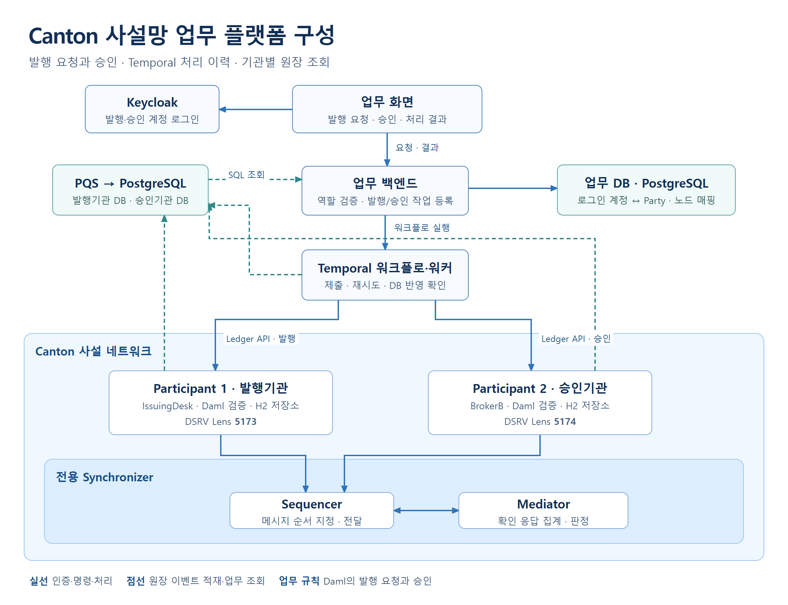

# Canton 사설망 업무 플랫폼

노트북 한 대에서 모의 증권의 발행 요청과 승인을 처리하고, 기관별로 원장을 조회하는 시연이다. 전용 Synchronizer와 Participant 두 개 위에 Daml 발행 계약, 업무 앱, Temporal, 기관별 읽기 DB를 연결했다.



## 거래가 처리되는 순서

1. **발행 요청** · 발행기관 계정으로 로그인하고 수량을 입력한다. 백엔드가 계정과 Party의 연결을 확인하고 Temporal에 작업을 등록한다. 워커가 발행기관 Participant에 `IssuanceRequest` 생성을 제출한다.
2. **기관 승인** · 별도 브라우저 세션에서 승인기관 계정으로 로그인해 대기 요청을 승인한다. 승인 작업이 승인기관 Participant에 `Approve`를 제출한다. Daml이 승인 Party를 확인하고 대기 계약을 소비하며 `IssuedHolding`을 생성한다. 승인 대기 상태는 원장 계약으로 저장된다.
3. **결과 확인** · PQS 두 개가 각 Participant의 Ledger API에서 이벤트를 읽어 각각 PostgreSQL에 적재한다. 워크플로는 생성된 계약이 두 조회 DB에 반영됐는지 확인한다. 원장 확정과 조회 DB 반영을 업무 화면에서 확인하고, 계약 자체는 양쪽 DSRV Lens에서 볼 수 있다.
4. **보내기** · 발행기관에서 **발행 완료 → 보내기**를 누르고 수량을 입력한다. 예를 들어 100개 중 30개를 보내면 70개를 계속 사용할 수 있고, 30개는 이전 수락 대기에 표시된다. 이전 버전에서 승인한 종목에도 같은 버튼을 사용한다.
5. **수락 또는 반환** · 상대 기관으로 로그인해 **이전 수락 대기 → 수락**을 누르면 해당 기관의 사용 가능 수량이 30개가 된다. 수락 전에는 수신자가 거절하거나 발신자가 회수할 수 있다. 수락 후에는 받은 기관에서도 다시 보낼 수 있다. 각 기관의 **내 원장 기록**에서 업데이트 ID를 대조한다.

첫 전송에서 Daml은 승인 계약을 한 번 소비하고, 승인 수량으로 Splice 테스트 토큰을 생성한 뒤 같은 트랜잭션에서 전송을 제안한다. 이후의 전송은 해당 소유자의 기존 토큰을 사용한다. 발행 번호가 종목을 식별하므로 이름이 같은 두 발행 건의 잔액이 섞이지 않는다. 이 시연은 등록된 두 Party 간의 무상 이전이며, 대금 결제와 투자자 등록은 별도 업무다. [업무 계약](model/daml/Issuance.daml) · [고정 버전 Splice 테스트 토큰](https://github.com/canton-network/splice/blob/17c6a5957eb2f193d9f7fa8f5283bbac5e30d9a1/token-standard/examples/splice-test-token-v1/daml/Splice/Testing/Tokens/TestTokenV1.daml)

발행 요청과 승인에 각각 워크플로 ID와 Canton 명령 ID를 부여한다. 같은 입력을 다시 제출하면 이전 실행 결과를 돌려주고, 같은 발행 요청 ID에 수량 등을 바꾸면 충돌을 반환한다. 일시 장애가 나면 워커가 PQS 생성 이력과 같은 Canton 명령 ID를 사용해 재시도한다. 원장이 확정됐는데 조회 DB 반영이 지연되면 업무 화면에는 **원장 확정 · 조회 DB 반영 대기**가 표시된다.

## 구성 요소와 재사용 코드

- **사설망** · Canton OSS `3.7.3`, Participant 두 개, Sequencer와 Mediator, 노드별 H2 저장소. [공식 simple-topology 예제](https://github.com/digital-asset/canton/tree/v3.7.3/community/app/src/pack/examples/01-simple-topology)
- **인증과 업무 앱** · Keycloak을 기존 Quickstart의 역할에 맞춰 로컬에 배치했다. Quickstart의 확인 모달과 명령 ID 유틸을 재사용했다. 발행 화면과 Ledger API 백엔드는 이 PoC에서 작성했다. [Quickstart 고정 버전](https://github.com/digital-asset/cn-quickstart/tree/374f2d6e04f66ab919a2fab27401834235ccecd9) · [재사용 소스 및 라이선스](src/upstream)
- **조회 DB** · 공식 PQS `3.6.2`의 배포 JAR를 사용한다. Quickstart의 기관별 PQS 분리 패턴을 Windows 로컬 실행에 적용했다. 발행기관의 `pqs_issuer`, 승인기관의 `pqs_broker`와 별개로, 연결 정보를 담는 `poc_workflow`를 만든다. 승인 상태는 Daml 계약에 기록한다. [Quickstart의 PQS 설정](https://github.com/digital-asset/cn-quickstart/blob/374f2d6e04f66ab919a2fab27401834235ccecd9/quickstart/docker/modules/pqs/compose.yaml) · [PQS 공식 소스](https://github.com/digital-asset/participant-query-store)
- **오케스트레이션** · Temporal CLI `1.10.1`과 TypeScript SDK `1.26.0`을 사용한다. [워크플로 정의](issuance-workflows.cjs)는 작업 순서와 재시도 설정을 담고, [워커의 작업 코드](issuance-activities.mjs)는 Canton 명령 제출과 두 PQS 확인을 맡는다. 로컬 서버는 실행 이력을 SQLite에 유지한다. [Temporal 공식 Quickstart](https://docs.temporal.io/quickstarts)
- **업무 규칙** · [Issuance.daml](model/daml/Issuance.daml)의 `IssuanceRequest`와 `IssuedHolding`. 승인자 선택과 계정·Party 매핑은 [provision.mjs](provision.mjs)에서 확인할 수 있다.

## 실행

Windows x64, JDK 21, Node.js 22.18 이상, Git, PowerShell이 필요하다. 저장소 루트에서 실행한다.

```powershell
# 설치·빌드 및 시작
.\Start-CantonPlatform.ps1 -Prepare
# 설치 후 다시 시작
.\Start-CantonPlatform.ps1
```

- [업무 화면](http://127.0.0.1:18090/) · [Temporal 워크플로 이력](http://127.0.0.1:8233/) · [발행기관 Lens](http://127.0.0.1:5173/#/contracts?template=Issuance%3AIssuedHolding) · [승인기관 Lens](http://127.0.0.1:5174/#/contracts?template=Issuance%3AIssuedHolding)
- 로컬 시연용 계정은 `%LOCALAPPDATA%\CantonPrivatePoc\runtime\platform-demo-accounts.json`에 생성된다. 계정이 다른 점을 보려면 각각 별도 브라우저 프로필 또는 일반 창과 InPrivate 창에서 연다.
- 실행 이력과 로그인 자격증명은 로컬 실행 폴더에 저장된다. 공개 GitHub 링크에는 이 문서, 구성도, 소스가 들어 있다. 위 화면 링크는 서비스를 실행한 PC에서 열 수 있다.

## 공식 Quickstart 데모와 이 앱

이 앱은 Quickstart의 Keycloak 인증, 기관별 PQS, 원장 명령·조회 분리 패턴을 전용 Synchronizer의 발행 업무에 적용한 Windows 실행 경로다. 공식 Quickstart가 제공하는 별도의 라이선스 거래 데모는 Java 백엔드와 Splice LocalNet을 사용한다. 원본 데모는 [공식 설치 전제조건](https://docs.canton.network/appdev/quickstart/prerequisites)과 [실행 절차](https://docs.canton.network/appdev/quickstart/running-the-demo)에서 재현할 수 있다.

## 2026-11-23 확인 기록

**확인됨 · 직접 실행.** Windows에서 모의 증권 125개 요청, 발행기관의 자체 승인 거절(HTTP 403), 승인기관 승인, 발행·승인 워크플로 완료, 두 기관의 PQS 계약 ID 일치를 검증했다. 같은 발행 요청을 재전송하면 같은 계약 ID가 반환됐고 수량을 바꾼 재전송은 HTTP 409로 거절됐다. 동시 승인 요청 두 건도 하나의 발행 계약으로 처리됐다.

**확인됨 · 워커 재시작.** 워커가 내려간 상태에서 Temporal에 모의 발행 작업을 등록했다. 워커를 다시 시작하자 대기 중이던 작업이 완료됐고 양쪽 PQS에서 새 계약이 확인됐다.

**확인됨 · 브라우저에서 이전.** 발행 앱 1.0.0에서 승인한 모의 자산 100개를 1.1.0에서 다시 발행하지 않고 사용했다. 두 계정의 브라우저에서 30개 전송 직후의 사용 가능 수량 70/0, 수락 후 70/30, 반대 방향 전송의 거절·회수 후 잔액 복구를 확인했다. 상대 기관이 10개를 돌려보내고 발행기관이 수락한 뒤의 잔액은 80/20이었다.

**확인 범위.** 로컬 발행·승인·이전·조회 흐름이다. 외부 서명, 별도 기관 시스템이나 타 체인과의 연결은 후속 통합 범위다.
